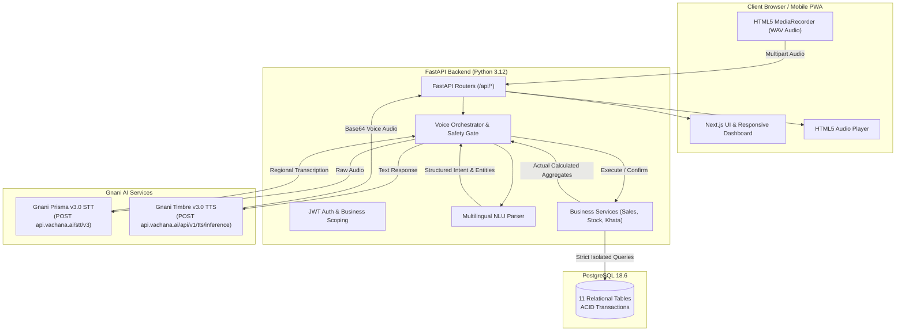
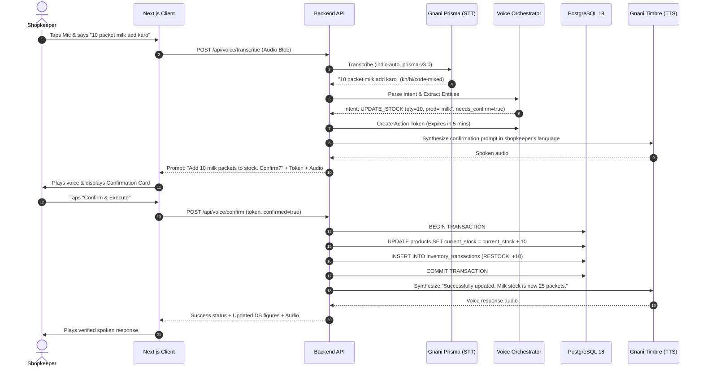

# VyaparVoice — System Architecture

## 1. Architectural Overview

VyaparVoice is structured around a three-tier decoupled architecture:
1. **Frontend Presentation Layer**: Mobile-first Next.js 14 App Router with Tailwind CSS, Lucide Icons, and Recharts.
2. **Backend Application Layer**: Asynchronous FastAPI service running on Python 3.12, orchestrating business logic, JWT security, and NLU intent validation.
3. **Data & AI Layer**: PostgreSQL 18.6 relational database and Gnani.ai AI Services (`Prisma` for STT and `Timbre` for TTS).

---

## 2. Voice Pipeline & Two-Phase Confirmation Flow

VyaparVoice adheres to the core philosophy: **"AI that doesn't just talk — it performs real, verified business actions."**

---

## 3. Database Integrity & Financial Separation

1. **Gross Profit vs Revenue**:
   - Gross Profit is strictly calculated using:
     $$\text{Gross Profit} = \sum (\text{Selling Price} - \text{Purchase Price Snapshot}) \times \text{Quantity}$$
   - The `purchase_price_snapshot` is frozen in `sale_items` at the moment of sale to prevent retroactive price shifts from distorting historical accounting.
2. **Customer Credit (Udhaar Ledger)**:
   - When a sale is made with `payment_method = 'Credit'`, an atomic debit is added to the customer's balance and logged in `credit_transactions`.
   - Repayments are recorded as positive credits, decrementing outstanding balance with full timestamping and payment tender logging.
3. **Inventory Isolation**:
   - Every product deduction is guarded against negative quantities unless explicitly configured.
   - Cancelled invoices trigger an automated rollback (`SALE_CANCEL_RESTORE`), returning quantities to stock and reversing any associated customer debt.
