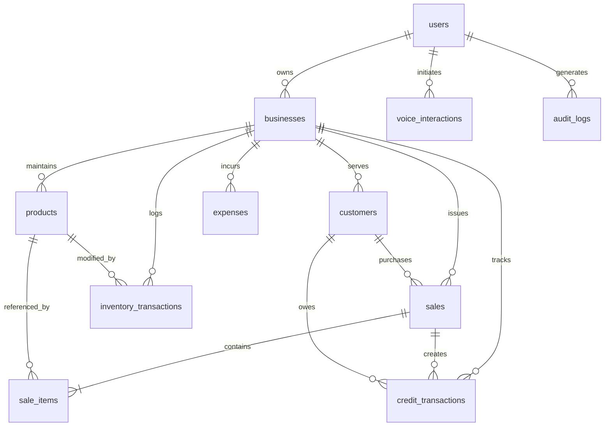

# VyaparVoice — PostgreSQL Database Schema

The database runs on PostgreSQL 18.6 with Alembic database migrations.

---

## Entity Details

### 1. `users`
- `id` (UUID, PK)
- `full_name` (VARCHAR(255), NOT NULL)
- `email` (VARCHAR(255), UNIQUE, INDEX)
- `hashed_password` (VARCHAR(255), NOT NULL)
- `phone` (VARCHAR(50), NULL)
- `preferred_language` (VARCHAR(20), DEFAULT 'en')
- `created_at`, `updated_at` (TIMESTAMPTZ)

### 2. `businesses`
- `id` (UUID, PK)
- `owner_id` (UUID, FK -> users.id, ON DELETE CASCADE)
- `business_name` (VARCHAR(255), NOT NULL)
- `business_type` (VARCHAR(100), DEFAULT 'Kirana / Grocery')
- `GSTIN` (VARCHAR(30), NULL)
- `currency` (VARCHAR(10), DEFAULT 'INR')
- `timezone` (VARCHAR(50), DEFAULT 'Asia/Kolkata')
- `address` (TEXT, NULL)
- `created_at` (TIMESTAMPTZ)

### 3. `products`
- `id` (UUID, PK)
- `business_id` (UUID, FK -> businesses.id, ON DELETE CASCADE)
- `product_name` (VARCHAR(255), INDEX, NOT NULL)
- `SKU` (VARCHAR(100), INDEX, NULL)
- `category` (VARCHAR(100), INDEX, DEFAULT 'General')
- `unit` (VARCHAR(50), DEFAULT 'pcs')
- `purchase_price` (NUMERIC(12,2), DEFAULT 0.0)
- `selling_price` (NUMERIC(12,2), DEFAULT 0.0)
- `current_stock` (NUMERIC(12,2), DEFAULT 0.0)
- `low_stock_threshold` (NUMERIC(12,2), DEFAULT 5.0)
- `created_at`, `updated_at` (TIMESTAMPTZ)

### 4. `sales`
- `id` (UUID, PK)
- `business_id` (UUID, FK -> businesses.id, ON DELETE CASCADE)
- `customer_id` (UUID, FK -> customers.id, NULL)
- `invoice_number` (VARCHAR(50), INDEX, NOT NULL)
- `subtotal` (NUMERIC(12,2), DEFAULT 0.0)
- `discount` (NUMERIC(12,2), DEFAULT 0.0)
- `tax` (NUMERIC(12,2), DEFAULT 0.0)
- `total_amount` (NUMERIC(12,2), DEFAULT 0.0)
- `payment_method` (VARCHAR(50), DEFAULT 'Cash')
- `payment_status` (VARCHAR(50), DEFAULT 'PAID')
- `created_at` (TIMESTAMPTZ, INDEX)

### 5. `sale_items`
- `id` (UUID, PK)
- `sale_id` (UUID, FK -> sales.id, ON DELETE CASCADE)
- `product_id` (UUID, FK -> products.id, RESTRICT)
- `quantity` (NUMERIC(12,2), NOT NULL)
- `unit_price` (NUMERIC(12,2), NOT NULL)
- `purchase_price_snapshot` (NUMERIC(12,2), NOT NULL)
- `total_amount` (NUMERIC(12,2), NOT NULL)

### 6. `customers`
- `id` (UUID, PK)
- `business_id` (UUID, FK -> businesses.id, ON DELETE CASCADE)
- `customer_name` (VARCHAR(255), INDEX, NOT NULL)
- `phone` (VARCHAR(50), INDEX, NULL)
- `address` (TEXT, NULL)
- `outstanding_balance` (NUMERIC(12,2), DEFAULT 0.0)
- `created_at` (TIMESTAMPTZ)

### 7. `credit_transactions`
- `id` (UUID, PK)
- `business_id` (UUID, FK -> businesses.id, ON DELETE CASCADE)
- `customer_id` (UUID, FK -> customers.id, ON DELETE CASCADE)
- `sale_id` (UUID, FK -> sales.id, NULL)
- `transaction_type` (VARCHAR(50), NOT NULL) -- CREDIT_GIVEN, REPAYMENT
- `amount` (NUMERIC(12,2), NOT NULL)
- `description` (VARCHAR(255), NULL)
- `created_at` (TIMESTAMPTZ, INDEX)

### 8. `expenses`
- `id` (UUID, PK)
- `business_id` (UUID, FK -> businesses.id, ON DELETE CASCADE)
- `category` (VARCHAR(100), INDEX, NOT NULL)
- `description` (VARCHAR(255), NULL)
- `amount` (NUMERIC(12,2), NOT NULL)
- `payment_method` (VARCHAR(50), DEFAULT 'Cash')
- `created_at` (TIMESTAMPTZ, INDEX)

### 9. `inventory_transactions`
- `id` (UUID, PK)
- `business_id` (UUID, FK -> businesses.id, ON DELETE CASCADE)
- `product_id` (UUID, FK -> products.id, ON DELETE CASCADE)
- `transaction_type` (VARCHAR(50), NOT NULL) -- RESTOCK, SALE_DEDUCT, ADJUSTMENT, SALE_CANCEL_RESTORE
- `quantity` (NUMERIC(12,2), NOT NULL)
- `reference_id` (VARCHAR(100), NULL)
- `description` (VARCHAR(255), NULL)
- `created_at` (TIMESTAMPTZ, INDEX)

### 10. `voice_interactions`
- `id` (UUID, PK)
- `business_id` (UUID, FK -> businesses.id, ON DELETE CASCADE)
- `user_id` (UUID, FK -> users.id, ON DELETE CASCADE)
- `input_language` (VARCHAR(20), DEFAULT 'auto')
- `transcription` (TEXT, NOT NULL)
- `detected_intent` (VARCHAR(100), NOT NULL)
- `execution_status` (VARCHAR(50), NOT NULL)
- `response_text` (TEXT, NOT NULL)
- `created_at` (TIMESTAMPTZ, INDEX)

### 11. `audit_logs`
- `id` (UUID, PK)
- `business_id` (UUID, FK -> businesses.id, ON DELETE CASCADE)
- `user_id` (UUID, FK -> users.id, NULL)
- `action` (VARCHAR(100), NOT NULL)
- `entity_type` (VARCHAR(100), NOT NULL)
- `entity_id` (VARCHAR(100), NOT NULL)
- `previous_value` (TEXT, NULL)
- `new_value` (TEXT, NULL)
- `created_at` (TIMESTAMPTZ, INDEX)

